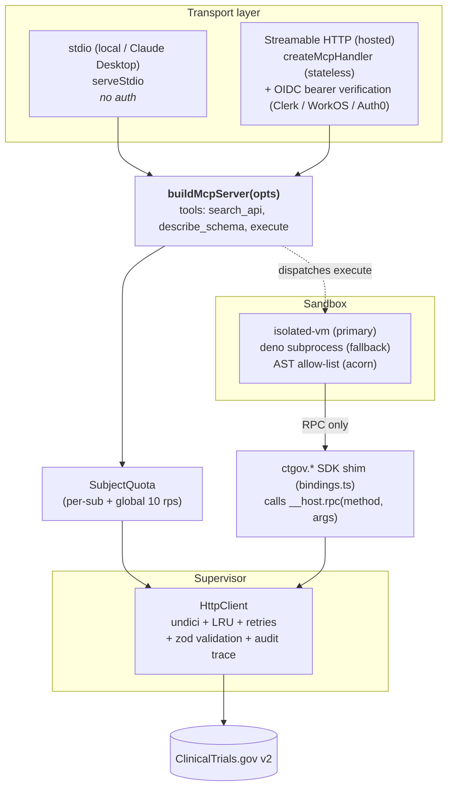

# Architecture

`@blen/clinicaltrial-mcp-server` is a code-mode MCP server that exposes the public
ClinicalTrials.gov v2 API through three tools (`search_api`,
`describe_schema`, `execute`) rather than one-tool-per-endpoint. The model
writes a short TypeScript body, we run it in a sandbox, and the sandbox's
only outbound path is a supervisor-backed `ctgov.*` SDK.

## Data flow (single `execute` call)

1. **MCP tools/call** reaches the server transport.
2. `buildMcpServer` routes to `runExecute` with the validated body.
3. `SubjectQuota.tryConsumeExecute(sub)` enforces per-subject rate.
4. `validateUserCode` (acorn AST pass) rejects blocked identifiers before a
   sandbox even spins up.
5. The selected `SandboxExecutor` runs the code inside an isolate (or Deno
   subprocess). The sandbox has exactly one capability: `ctgov.*` via RPC.
6. Every `ctgov.*` call crosses the RPC bridge, hits `buildRpcDispatch` in
   the host, flows into `CtGovRuntime` which validates args with zod, and
   finally reaches `HttpClient` which applies:
   - subject-aware rate limiting (`acquireFn` hook),
   - LRU cache lookup,
   - retry with exponential backoff + jitter on 408/425/429/5xx,
   - stale-cache fallback when upstream fails after retries exhaust,
   - audit recording.
7. Result returns to the sandbox, optionally logged via the bridged
   `console.*`, and the final return value is serialized and returned to the
   client as the tool result.

## Security boundaries

| Boundary | Enforcement |
|---|---|
| User code → host | V8 isolate (or Deno `--allow-none` subprocess), no net/fs/env/ffi |
| User code → direct escape hatches | acorn AST preflight rejects imports, eval, host-bridge access, and unsafe prototype/property chains before execution |
| Incoming HTTP | Audience-bound, asymmetric, scope-checked JWT on every request (no sessions), RFC 9728 PRM, Host validation (421), Origin validation on the anonymous endpoint, 1 MiB body cap, optional WAFv2 allow-list |
| Pre-auth flood control | `IpRateLimiter` — per-IP token bucket on `/mcp` and the OAuth metadata (5 rps / 20 burst default, client address from `CTGOV_CLIENT_IP_HEADER`), runs before JWT verification |
| Per-subject fair use | SubjectQuota (60 execute/min, 600 upstream/min) |
| Global upstream fair use | 10 rps token bucket (CT.gov documented limit) |
| Upstream credential leakage | Credentials live only in the supervisor's HttpClient; the sandbox never sees them |

## Auth providers

`clerk`, `workos`, `auth0` and `generic-oidc` all verify bearer tokens the same way
(`OidcVerifier` in `src/server/authz.ts`): issuer, audience, `exp` and `sub` required, asymmetric
algorithms only, every configured scope present, keys from an `https` JWKS. `none` is for stdio,
`--public-docs` and `--insecure` only. There is no embedded authorization server.

## OAuth metadata

- `/.well-known/oauth-protected-resource` — RFC 9728 PRM advertising our
  `resource`, the trusted AS, and supported scopes.
- The authorization server's own metadata is read by clients from the issuer
  named in the PRM; this server does not proxy it.
- `WWW-Authenticate: Bearer resource_metadata="…"` on every 401
  so clients can discover the AS via the PRM.
