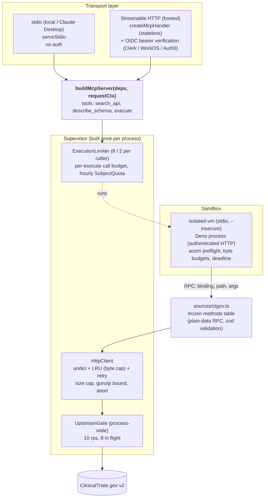

# Architecture

`@blen/clinicaltrial-mcp-server` is a code-mode MCP server that exposes the public
ClinicalTrials.gov v2 API through three tools (`search_api`,
`describe_schema`, `execute`) rather than one-tool-per-endpoint. The model
writes a short JavaScript body, we run it in a sandbox, and the sandbox's
only outbound path is a supervisor-backed `ctgov.*` SDK.

## Data flow (single `execute` call)

1. **MCP tools/call** reaches the server transport. The HTTP transport builds a thin MCP server per
   request on top of the supervisor's shared dependencies, so the cache, the gate and the limiters
   outlive requests.
2. `execute` asks the `ExecutionLimiter` for a slot (the token's subject, or the client address on
   `--insecure`) and answers `Busy` over a cap. It creates one `AbortController` that combines the
   MCP request's signal, server shutdown and the end of the execution.
3. The runner parses the code twice (as a script wrapper and as a module) and rejects banned names or a
   closed wrapper; then runs it with a host-owned deadline, memory limit and byte budgets (result, logs,
   SDK arguments, pending calls).
4. Every `ctgov.*` call crosses the bridge as `{binding, path, args}`. The per-execute call budget and
   the subject's hourly quota are charged, then `dispatch` resolves `path` as an own data property of
   the frozen methods table. The method validates its arguments with zod and calls `HttpClient`, with
   the execution's signal carried by `AsyncLocalStorage`.
5. `HttpClient` serves from the LRU cache or joins an identical request in flight, otherwise waits for
   a gate slot, sends the request under an absolute deadline, reads the body under a size cap
   (bounded gunzip), and retries 5xx and network errors with backoff and a 429 once after the shared
   pause. Every wait and the request itself stop when the signal aborts.
6. The result returns as `{ok, value, logs, error?, durationMs}`; an SDK error keeps its name, message
   and status. A sandbox process that has not exited yet keeps its execution slot until it has.

## Security boundaries

| Boundary | Enforcement |
|---|---|
| User code to host | isolated-vm isolate (stdio, `--insecure`) or a Deno child process with no permissions (authenticated HTTP): no net/fs/env/ffi, `--disallow-code-generation-from-strings`, module Worker with a global allowlist, RSS watchdog, process-group kill, minimal environment, stderr never shown |
| User code to escape hatches | dual-parse acorn preflight rejects imports, `eval`, `Function`, `globalThis`, `Deno`, `fetch`, `constructor`, `__proto__`, string-keyed forms of them and a closed wrapper; the SDK is plain-data RPC over a frozen methods table |
| Sandbox to host | token-prefixed frames the user code cannot forge, size-bounded and validated; result, log and argument budgets enforced in the sandbox and again on the host; the execution settles once |
| Incoming HTTP | Audience-bound, asymmetric, scope-checked JWT on every request (no sessions), RFC 9728 PRM, Host validation (421), Origin validation on the anonymous endpoint, 1 MiB body cap (also in the Node adapter), optional WAFv2 allow-list |
| Pre-auth flood control | `IpRateLimiter`: per-IP token bucket on `/mcp` and the OAuth metadata (5 rps / 20 burst default, client address from `CTGOV_CLIENT_IP_HEADER`), runs before JWT verification |
| Execution fair use | `ExecutionLimiter` (8 simultaneous, 2 per caller), per-execute call budget (100), hourly per-subject upstream quota (3000, authenticated only) |
| Global upstream fair use | one process-wide `UpstreamGate`: 10 rps (`CTGOV_RATE_PER_SEC`), 8 in flight; a 429 pauses every caller |

## Auth providers

`clerk`, `workos`, `auth0` and `generic-oidc` all verify bearer tokens the same way
(`OidcVerifier` in `src/server/authz.ts`): issuer, audience, `exp` and `sub` required, asymmetric
algorithms only, every configured scope present, keys from an `https` JWKS. `none` is for stdio,
`--public-docs` and `--insecure` only. There is no embedded authorization server.

## OAuth metadata

- `/.well-known/oauth-protected-resource` — RFC 9728 PRM advertising our
  `resource`, the trusted AS, and supported scopes.
- The authorization server's own metadata is read by clients from the issuer
  named in the PRM; this server does not proxy it.
- `WWW-Authenticate: Bearer resource_metadata="…"` on every 401
  so clients can discover the AS via the PRM.
