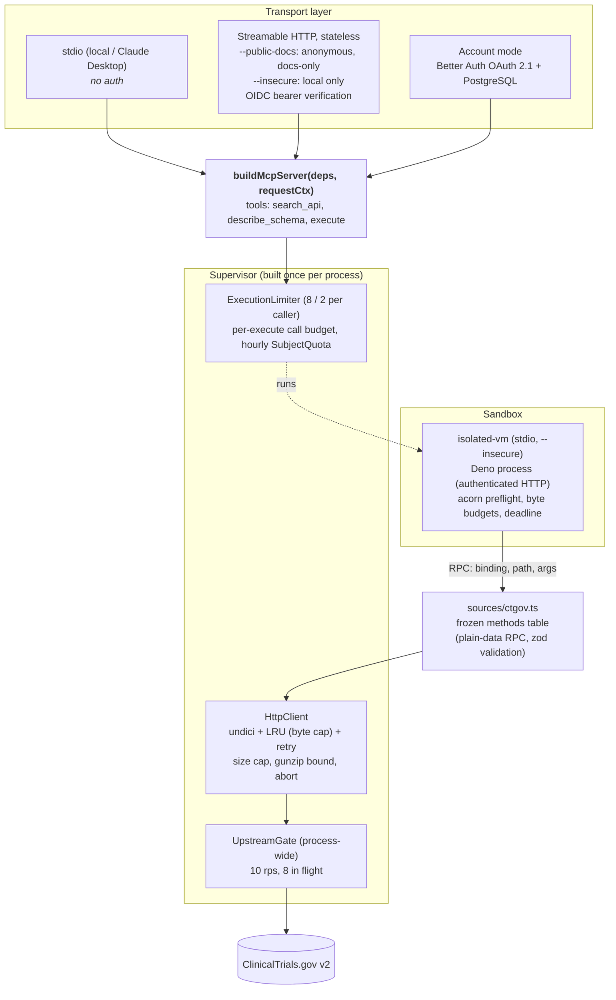

# clinicaltrials-mcp-server architecture

## Overview

```text
Transport (stdio | Streamable HTTP: --public-docs, --insecure, OIDC | account mode)
    ↓
buildMcpServer  (search_api | describe_schema | execute)
    ↓
Supervisor  (source + corpus + sandbox + execution limiter + budgets/quotas)
    ↓
SDK binding  ctgov.*  (ClinicalTrials.gov API v2, clinicaltrials.gov/api/v2)
    ↓
HttpClient  (undici + upstream gate + size-bounded LRU + retries + caps)
    ↓
ClinicalTrials.gov
```

The server exposes exactly three MCP tools, the "code-mode" pattern:

| Tool | Purpose |
|---|---|
| `search_api` | BM25 over the SDK method docs and the study-field dictionary |
| `describe_schema` | Exact path lookup or namespace enumeration (`prefix`) |
| `execute` | Run JavaScript (no type annotations) in a sandbox against the `ctgov` global |

Each tool advertises a `title`, an `inputSchema` (from Zod 4's `z.toJSONSchema`, so integer, minimum,
maximum and length constraints and `describe_schema`'s "exactly one of `path` or `prefix`" rule are
visible to clients), an `outputSchema`, and MCP annotations: all three are `readOnlyHint: true` and
`destructiveHint: false`; only `execute` sets `openWorldHint: true`. Annotations are hints for
clients; enforcement is the sandbox and the method allowlist below.

Results are compact JSON text plus the same object as `structuredContent`. A failed `execute`
(thrown error, timeout, byte limit, `Busy`, ...) is returned with `isError: true` **and** the full
envelope `{ ok: false, error: { name, message, status? }, logs, durationMs }`, so the model can see
what went wrong. Argument validation failures and handler exceptions are `isError` too; an unknown
tool name (including `execute` where it is not offered) is a JSON-RPC error.



## SDK binding

One global, `ctgov`, is injected into the sandbox. It is read-only and has three namespaces:

- **`ctgov.studies`**: `search`, `get`, `metadata`, `searchAreas`, `enums`.
- **`ctgov.stats`**: `size`, `fieldValues`, `fieldSizes`.
- **`ctgov.version()`**: the API's data version.

The client is implemented in TypeScript on the host (`src/sdk/ctgov-client.ts`) and exposed inside the
sandbox as a Proxy that RPCs back to the host. The host resolves the dotted path as an own data
property of the explicit, frozen methods table in `src/sdk/sources/ctgov.ts` and invokes it; the
method validates its arguments with Zod (`src/sdk/validation.ts`) and issues a parameterized HTTP
request. Nothing is resolved by traversing the client object or inherited properties, so a new SDK
method is unreachable until it is registered. `studies.search` takes **flat dotted string keys**
(`query.cond`, `filter.overallStatus`); nested objects and unknown keys are rejected with a
`ValidationError` before any request is made. NCT ids must be `NCT` plus eight digits.

ClinicalTrials.gov needs no credential, so the binding holds none. The surface is documented in
[sdk-reference.md](./sdk-reference.md); its method section is generated from `schema/ctgov.json`.

## Rate limits and guardrails

ClinicalTrials.gov publishes no rate limit, so the server keeps its own conservative one. Every
request from every caller leaves through one process-wide `UpstreamGate` (`src/util/upstreamGate.ts`):

- at most 10 requests a second (`CTGOV_RATE_PER_SEC`) and 8 in flight, with a wait of at most 15 s;
- a `429` pauses the gate for the `Retry-After` and retries the call once; a pause over 30 s fails
  at once with `RateLimited`; network errors and `5xx` retry up to three times with backoff.

Budgets sit in front of the gate:

| Budget | Default | Counted |
|---|---|---|
| SDK calls per `execute()` | 100 (`CTGOV_MAX_CALLS_PER_EXECUTE`) | every call, including ones the cache answers; `CallBudgetExceeded` |
| SDK calls per authenticated subject per hour | 3000 (`CTGOV_SUBJECT_RATE_PER_HOUR`) | charged before the cache; in memory, or in PostgreSQL in account mode; `SubjectQuotaExceeded` |
| Simultaneous executions | 8 per server, 2 per caller | the subject, or the client address under `--insecure`; `Busy` beyond |
| Requests per client address (HTTP) | 5 a second, burst 20 (`CTGOV_IP_RPS`, `CTGOV_IP_BURST`) | in memory per replica, before authentication; `429` |

The gate, the cache and the address limiter live in memory, so a deployment runs **one replica**
(and avoids deploys where an old and a new instance serve at once), or the process-wide rate is no
longer shared.

## Executions

`execute` asks the `ExecutionLimiter` for a slot (the token's subject, or the client address on
`--insecure`) and answers `Busy` over a cap. It creates one `AbortController` combining the MCP
request's signal, server shutdown and the end of the execution; aborting it stops the sandbox and
every upstream call in flight. A sandbox process that has not exited yet keeps its slot until it has.

Every `ctgov.*` call crosses the bridge as `{binding, path, args}`. The per-execute budget and the
subject's hourly quota are charged, then the path is dispatched. The execution's signal reaches
`HttpClient` through `AsyncLocalStorage` (`src/util/executionContext.ts`), so every wait and the
request itself stop when it aborts. The result returns as `{ok, value, logs, error?, durationMs}`; an
SDK error keeps its name, message and status all the way out.

## Caching and responses

`HttpClient` (`src/util/httpClient.ts`) serves from an in-memory LRU cache (5 minutes, 500 entries
and 32 MiB), or joins an identical request already on the wire (the shared request is aborted only
when every waiting caller has aborted). Otherwise it waits for a gate slot, sends the request under an
absolute deadline (20 s) and reads the body under a size cap: an upstream body over 8 MiB fails with
`ResponseTooLarge`, and gzip is expanded under the same bound. Responses of `400` and above are never
cached. The result a program returns is capped at 256 KiB (`ResultTooLarge`), so programs pass
`fields` and return only what they need.

## Sandbox

User code never runs in the server's own context unprivileged. Two runners implement the same
contract (`src/sandbox/types.ts`):

1. **`isolated-vm`** (`src/sandbox/isolate.ts`): a fresh V8 isolate per execution, with a heap cap
   (`memoryMb`, default 64, 16 to 256) and a host-enforced wall-clock deadline (`timeoutMs`, default
   15 s, 100 ms to 60 s). For one user: stdio and `--insecure` HTTP.
2. **Deno** (`src/sandbox/deno.ts`): a separate `deno run` process with no permissions (no net, files,
   env, ffi or subprocesses; `--no-prompt --no-remote --no-npm`,
   `--disallow-code-generation-from-strings`), a module Worker with a global allowlist, a minimal
   environment, a resident-memory watchdog (twice `memoryMb` plus 96 MiB of growth), and a process-group
   kill when the deadline passes. Authenticated HTTP (OIDC and account mode) runs code **only** here:
   `--sandbox isolate` is refused, and without Deno `execute` answers `SandboxUnavailable` instead of
   falling back. `--public-docs` creates no sandbox at all.

Before either runs, a dual-parse acorn preflight (`src/sandbox/policy.ts`) parses the code as a
script wrapper and as a module, rejects banned globals and members (`process`, `require`,
`globalThis`, `eval`, `Function`, `Deno`, `fetch`, `constructor`, `__proto__`, string-keyed forms of
them, imports) and a closed wrapper. The frames between sandbox and host carry a token the user code
cannot forge, are size-bounded and validated, and the execution settles once. The byte budgets in
`src/sandbox/limits.ts` (code 256 KiB, result 256 KiB, logs 64 KiB or 1,000 lines, SDK arguments
64 KiB, 100 pending calls) are enforced inside the sandbox and again on the host.

## Corpus

`search_api` and `describe_schema` read one corpus built at startup from `schema/ctgov.json`: the
nine SDK methods plus the study-field dictionary (the fields of the ClinicalTrials.gov data model, one
entry each, with a path such as `ctgov.fields.protocolSection.statusModule.overallStatus`) and the
syntax entries (`ctgov.syntax.search`, `.essie`, `.geo`, `.paging`, `.errors`). `search_api` ranks
with BM25 (`src/search/bm25.ts`) over id, description, signature and example, and returns
`{hits, note}` (`k` defaults to 10, at most 50). `describe_schema` returns `{found: true, entries}`
or `{found: false, message}` for exactly one of an exact `path` or a namespace `prefix`; bare field
paths do not match, only full corpus ids do. The same corpus is served in every mode, and neither
tool calls ClinicalTrials.gov, which is why they are safe to offer anonymously.

## Streamable HTTP transport

`src/server/http.ts` implements the stateless MCP `2026-07-28` Streamable HTTP profile (no
`initialize` handshake and no `Mcp-Session-Id`, routing from the `Mcp-Method` and `Mcp-Name` headers)
with a stateless legacy fallback for clients that still send `initialize`. The factory builds a thin
MCP server per request on top of the supervisor's shared dependencies, so the cache, the gate and the
limiters outlive requests, and the subject a tool sees is always the one this request's own token
verified as. It fails closed.

| Mode | Flag | Authentication | Tools | Serves |
|---|---|---|---|---|
| Docs-only | `--http --public-docs` | none | `search_api`, `describe_schema` | `/mcp`, `/health`, `/docs/`, and the docs-only portal: `/`, `/privacy-policy`, `/terms`. No sign-in. This is BLEN's hosted service. |
| Local | `--http --insecure` | none, loopback by default | all three | `/mcp`, `/health` |
| OIDC | `--http` + `CTGOV_AUTH_PROVIDER` `clerk`, `workos`, `auth0` or `generic-oidc` | bearer JWT | all three | `/mcp`, `/health`, protected-resource metadata |
| Accounts | `--http` + `CTGOV_AUTH_PROVIDER=accounts` | Google sign-in, OAuth 2.1 | `/mcp`: docs tools; `/mcp/account`: all three | everything below |

The modes exclude each other: `--public-docs` or `--insecure` next to any provider is a startup
error, and so is `accounts` without `--http`.

- **Host and Origin.** Every request's `Host` must match the configured names (`CTGOV_PUBLIC_ORIGIN`,
  `CTGOV_ALLOWED_HOSTS`, loopback on the listening port): `421` otherwise. `/health` is exempt. The
  trusted origin is never taken from the request. On the anonymous endpoint, a browser `Origin` that is
  not the server's own, loopback or in `CTGOV_ALLOWED_ORIGINS` gets `403`; bearer-authenticated
  endpoints accept any Origin because hosted connectors send their own.
- **Bodies.** Capped at 1 MiB, in the Node adapter as well as the handler; tool arguments are limited
  to 64 elements.
- **Order.** Health, then the Host check, then the static pages (`/docs`, and in docs-only mode the
  portal pages), then the per-address limiter, then metadata and `/mcp`.
- **OIDC.** `OidcVerifier` (`src/server/authz.ts`) requires the issuer, the audience, `exp` and `sub`,
  asymmetric algorithms only, every scope in `CTGOV_AUTH_SCOPES` (default `ctgov:read`; `403
  insufficient_scope` otherwise) and keys from an https JWKS (http only on loopback). A `401`
  carries `WWW-Authenticate: Bearer resource_metadata="…"`; the metadata is served at
  `/.well-known/oauth-protected-resource/mcp` and at the un-suffixed path (RFC 9728), and names the
  configured issuer, which clients query themselves: this server proxies no authorization-server
  metadata.
- **Shutdown.** SIGTERM or SIGINT stops accepting, aborts every running execution and closes.

### Account mode

Account mode (`src/accounts/`) is an option for a self-hosted server; BLEN's hosted service does not
use it. It runs an Express app that embeds Better Auth as an OAuth 2.1 authorization server (Google
sign-in, dynamic client registration or CIMD, S256 PKCE) over PostgreSQL, serves the portal (`/`,
`/sign-in`, `/consent`, `/account`, `/error`, the policy pages), the portal's JSON API
(`/api/portal/*`), two MCP endpoints (`/mcp` for the documentation tools, `/mcp/account` for all three
behind a bearer token), `/.well-known/oauth-protected-resource/mcp` and
`/.well-known/oauth-authorization-server`, and `/docs`. It keeps per-account quotas in PostgreSQL,
and its `/health` runs a database check. [accounts.md](./accounts.md) is the full guide.

### Portal and documentation site

- **`web/`** is a React portal built with Vite twice from the same sources (`pnpm build:web`). The
  default build (`dist/web`) is the account-mode portal. The `docs-only` build (`dist/web-docs`)
  replaces the brand with `web/src/docs-only/brand.tsx` (no accounts), builds only the home page and
  the two policies, and prerenders all of them, so they read without JavaScript. The docs-only server
  serves them with a CSP of same-origin files only (`src/accounts/docs.ts`).
- **`site/`** is the documentation site (Astro Starlight, base `/docs`; its own pnpm root and
  lockfile). `deploy/Dockerfile` builds it into `docs-site/`, a sibling of `dist/` that the npm package
  never ships; the server serves it at `/docs` with its own CSP (inline scripts only by hash). Its SDK
  reference page is `docs/sdk-reference.md` copied in at build time.
- **`legal/`** holds the privacy policy and terms, bundled into both portal builds.

## Layout

```text
src/
  bin.ts                  CLI and environment mapping, startup rules
  index.ts                the package's public entry (exports.spec.ts lists its names)
  project.ts              the repository address the server's own code uses
  server/                 mcpServer, toolCatalog, http, stdio, authz, wellKnown, ipRateLimiter
  tools/                  search_api, describe_schema, execute
  supervisor/             builds the shared dependencies once per process
  sdk/                    ctgov client, frozen methods table (sources/), Zod validation, RPC runtime
  search/                 corpus and BM25
  sandbox/                isolated-vm and Deno runners, acorn policy, byte limits
  util/                   HttpClient, upstream gate, limiters, quotas, logger, execution context
  accounts/               account mode: Better Auth, PostgreSQL store, portal API, static pages
schema/ctgov.json         the corpus: methods, field dictionary, syntax entries
web/                      portal (account-mode and docs-only builds) and browser tests (web/e2e)
site/                     documentation site
docs/                     architecture, accounts, accessibility, generated SDK reference
examples/                 programs for `execute`, tested by test/examples.spec.ts
legal/                    privacy policy and terms
deploy/Dockerfile         the image: Node 26, Deno, the portal and the site
.railway/railway.ts       Railway settings (config as code)
```
